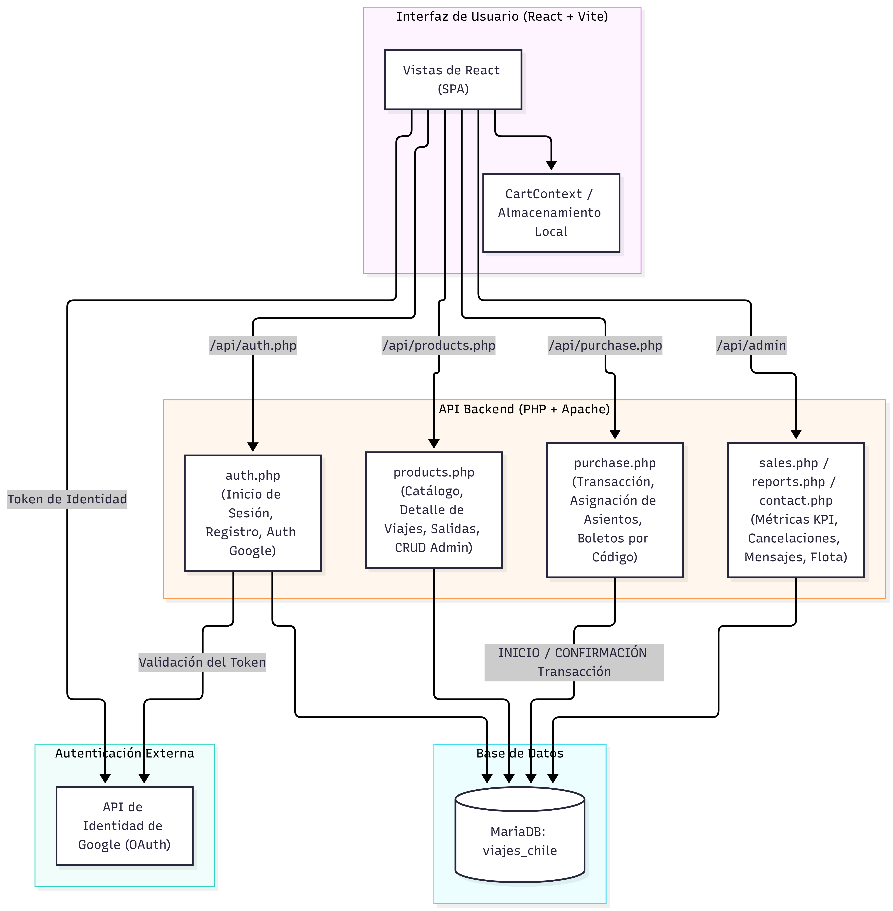

# Especificación de Requisitos de Software (ERS)

**Proyecto:** Viajes por Chile
**Versión del documento:** 1.0
**Estado:** Actualizado según el comportamiento implementado en el repositorio
**Propósito:** Describir el alcance verificable de la aplicación y distinguir las funciones implementadas de las demostraciones y exclusiones.

## 1. Propósito y alcance

Viajes por Chile es una aplicación web para explorar rutas de bus dentro de Chile, consultar precios y salidas, reservar pasajes y emitir boletos en una compra simulada. Cuenta con un espacio de administración para mantener las rutas y sus descuentos, revisar cuentas compradoras y consultar métricas calculadas desde MariaDB.

El alcance incluye la interfaz web SPA, la API REST Spring Boot y la persistencia local en MariaDB. XAMPP puede usarse para ejecutar MariaDB en desarrollo; la aplicación no requiere Apache ni PHP. La compra no procesa dinero real ni se conecta a una pasarela de pago.

## 2. Tipos de usuario

| Usuario | Necesidades y permisos |
|---|---|
| Visitante | Explorar y filtrar rutas, calcular tarifas, consultar descuentos, registrar una cuenta y enviar consultas. |
| Cliente | Iniciar sesión, elegir una salida, ingresar datos de pasajeros, conservar pasajes en el carrito y consultar los boletos emitidos. |
| Administrador | Mantener rutas, descuentos y salidas; revisar cuentas compradoras y acceder al panel de reportes. |

La autorización de administrador y vendedor se comprueba en la interfaz y en los endpoints protegidos de Spring Boot. La autenticación utiliza JWT de acceso de corta duración y refresh tokens rotatorios en cookie HttpOnly; los hashes BCrypt y los hashes de refresh tokens se almacenan en MariaDB. El vendedor puede consultar productos y el listado de órdenes; no puede crear compras, modificar datos ni acceder a otras rutas REST.

## 3. Requisitos funcionales

| ID | Requisito | Criterio de aceptación |
|---|---|---|
| RF-01 | Explorar rutas y destinos. | El usuario puede consultar el catálogo y abrir el detalle de una ruta. |
| RF-02 | Buscar y clasificar rutas. | El usuario puede buscar por destino y filtrar por tipo de servicio (Clásico, Semi Cama, Salón Cama o Premium); puede volver a mostrar todos los servicios. |
| RF-03 | Calcular una tarifa de referencia. | La página de rutas calcula distancia y tarifa para dos ciudades distintas; muestra validación si el trayecto no es válido. |
| RF-04 | Consultar descuentos. | `/descuentos` lista rutas con descuento, presenta el precio normal y el precio rebajado y enlaza al detalle de la ruta. |
| RF-05 | Administrar el catálogo. | Un administrador puede crear, editar y eliminar rutas. Al guardar puede configurar tipo, estado, precio, descuento y salidas. |
| RF-06 | Reservar una salida. | En el detalle, el usuario puede elegir fecha/salida, cantidad de pasajes y datos de pasajeros antes de añadirlos al carrito. |
| RF-07 | Mantener el carrito. | El carrito muestra cantidades, precio aplicado, salida y total; sus artículos se conservan en `localStorage`. No permite iniciar la compra si a un pasaje le falta una salida seleccionada. |
| RF-08 | Completar una compra simulada. | La aplicación envía pasajeros y salidas a la API; la API registra la compra, reserva los asientos disponibles y devuelve el código de compra y los boletos. No se efectúa un cobro. |
| RF-09 | Consultar e imprimir boletos. | `/boletos/:saleCode` muestra pasajero, RUT, ruta/destino, fecha, hora, andén, asiento, precio y descuento. Permite imprimir/guardar como PDF o descargar un HTML imprimible. |
| RF-10 | Administrar cuentas compradoras. | Un administrador puede consultar el listado de usuarios compradores. Las cuentas administrativas no se presentan como cuentas de cliente. |
| RF-11 | Consultar reportes de operación. | `/admin/reportes`, visible desde el espacio de administración, permite elegir Hoy (Día), Esta Semana, Este Mes y Este Año y presenta monto, viajes, cancelaciones, reclamos y eventos de flota. |
| RF-12 | Enviar una consulta. | El formulario de ayuda valida los campos y envía el mensaje a la API para guardarlo en MariaDB; muestra confirmación o un error explícito. |
| RF-13 | Crear una cuenta e iniciar sesión. | El registro valida coincidencia de correos y contraseñas; el inicio de sesión consulta la API y dirige según el rol autorizado. |
| RF-15 | Iniciar sesión con Google. | El login muestra el botón de Google Identity Services; la API valida la credencial con Google, comprueba la audiencia y el correo verificado, crea la cuenta de cliente si no existe y devuelve un JWT. |
| RF-14 | Consultar información institucional. | El visitante puede abrir las páginas de blog y de información del proyecto/equipo. |
| RF-16 | Consultar órdenes como vendedor. | Un usuario con rol `seller` puede listar órdenes y leer productos; las demás solicitudes REST se deniegan. |

### 3.1 Límite funcional importante

El panel `/admin/reportes` calcula sus métricas a partir de las ventas, cancelaciones, reclamos, usuarios y eventos de flota almacenados en MariaDB. Las filas agregadas por los seeds son datos de demostración, no actividad real de clientes.

## 4. Requisitos no funcionales

| ID | Requisito | Verificación/nota |
|---|---|---|
| RNF-01 | Interfaz adaptable. | La aplicación combina Bootstrap con reglas CSS y breakpoints propios para ajustar navegación, formularios y grillas a pantallas menores. |
| RNF-02 | Separación de responsabilidades. | La SPA organiza presentación, páginas, contextos compartidos, catálogo y acceso a API en módulos distintos. |
| RNF-03 | Persistencia local de la información de negocio. | Spring Data JPA y MariaDB usan la base `viajes_chile`; la conexión se configura con `DB_URL`, `DB_USER` y `DB_PASSWORD`. |
| RNF-04 | Seguridad básica de cuentas. | Las contraseñas se almacenan y verifican con BCrypt. Las operaciones protegidas requieren un JWT firmado y validado por la API; no se debe publicar `JWT_SECRET` ni usar la configuración `root` sin contraseña en producción. |
| RNF-05 | Manejo de errores. | La interfaz presenta errores de API en vez de mostrar confirmaciones ficticias cuando falla una solicitud. |
| RNF-06 | Verificabilidad. | Vitest, React Testing Library, `user-event` y jsdom permiten ejecutar pruebas unitarias y de componentes desde los scripts npm del proyecto. |
| RNF-07 | Instalación reproducible del frontend. | Las dependencias JavaScript se restauran a partir de `package-lock.json` con `npm ci`; el backend requiere Java 17 y Maven. |

## 5. Interfaces y arquitectura

- **Frontend:** React, React Router, Vite, Bootstrap y Bootstrap Icons.
- **API:** Spring Boot bajo `/api/v1`; la SPA realiza solicitudes JSON con JWT Bearer. En desarrollo, Vite reenvía `/api` a `http://localhost:8080`. Diagramas de arquitectura, endpoints y flujo de compra: [diagrama de APIs](./diagrama-apis.md).

- **Datos:** MariaDB/MySQL, esquema `database/schema.sql` y migración de descuentos, salidas y boletos en `database/migrations/`.
- **Persistencia de interfaz:** el carrito se almacena en `localStorage`; catálogo, usuarios, mensajes, ventas y boletos usan endpoints de la API.
- **Configuración local de base:** `127.0.0.1:3308`, base `viajes_chile`, usuario `root`, contraseña vacía como valor por defecto local o `DB_PASSWORD` si está definida.

### Rutas principales

| Ruta | Acceso / objetivo |
|---|---|
| `/menu` | Catálogo, búsqueda, filtro de tipo de servicio y cálculo de tarifa. |
| `/viajes/:slug` | Detalle, descuentos, salidas y reserva. |
| `/descuentos` | Ofertas actuales del catálogo. |
| `/` y `/registro` | Inicio de sesión y registro. |
| `/servicio`, `/blog`, `/nosotros` | Ayuda, contenido e información institucional. |
| `/boletos/:saleCode` | Resultado de la compra y boletos. |
| `/admin` | Administración del catálogo. |
| `/admin/usuarios` | Listado de cuentas compradoras, solo administración. |
| `/admin/reportes` | Métricas operacionales, solo administración. |

## 6. Datos y reglas del dominio

El esquema contempla productos/rutas, usuarios, mensajes de contacto, ventas y boletos. La migración añade los datos de descuentos, salidas y asientos necesarios para la reserva.

- Un precio rebajado depende del precio normal de la ruta y del porcentaje que mantiene el administrador.
- Cada pasaje que se compra requiere una salida; el precio enviado por el navegador no reemplaza la comprobación del precio y de cupos que debe realizar la API.
- Cada pasajero recibe un asiento y un boleto ligado a la compra.
- El carrito es una preparación de la compra en el navegador; la compra persistida y los boletos se confirman por API.

## 7. Restricciones, supuestos y exclusiones

1. Se asume un entorno local con Java 17, Maven y MariaDB/MySQL; XAMPP puede proporcionar la base de datos.
2. El host, puerto, nombre de base y usuario indicados son la configuración predeterminada del proyecto; la contraseña puede configurarse como variable de entorno `DB_PASSWORD`.
3. La operación está diseñada para un ejercicio/demostración, no para cobros ni despliegue público.
4. La compra es simulada; no hay pasarela, liquidación ni comprobante de pago financiero.
5. Los datos de demostración de los seeds no representan actividad real; los reportes consultan los registros persistidos.
6. El material de demostración `database/seeds/demo_trips.sql` contiene fechas fijas; si ya vencieron, se deben crear salidas futuras desde administración antes de exponer el flujo.
7. La cobertura de pruebas no es exhaustiva ni significa que cada función del proyecto tenga un caso. El informe asociado describe métricas, alcance y brechas.

## 8. Trazabilidad con la evaluación

| Área de la pauta | Evidencia en el proyecto |
|---|---|
| Framework frontend | React + Vite, configuración en `package.json` y `vite.config.js`. |
| Componentes, estado y navegación | Páginas y componentes reutilizables, estado local/contextos y rutas React Router. |
| Adaptabilidad | Bootstrap (sistema de grilla `row`/`col-*` en el catálogo), CSS responsive y reglas media-query en `src/styles.css`. |
| Pruebas | 43 casos automatizados con Vitest/React Testing Library, con mocks y spies; detalle y limitaciones en [informe de cobertura](./cobertura-de-pruebas.md). Jasmine y Karma se omiten según el alcance solicitado. |
| Persistencia e interactividad | API Spring Boot/MariaDB con JWT, carrito, catálogo administrable, formulario de contacto y emisión de boletos. |
