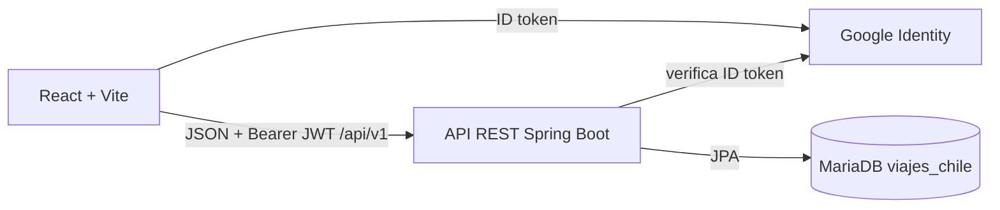

# Diagrama de APIs y lógica de negocio

## Arquitectura



En desarrollo, Vite reenvía `/api` a `http://localhost:8080`.

## Endpoints

| Endpoint | Métodos | Acceso | Función |
|---|---|---|---|
| `/api/v1/auth/register` | POST | Público | Crea una cuenta cliente y guarda su contraseña con BCrypt. |
| `/api/v1/auth/login` | POST | Público | Verifica correo y contraseña; responde con access JWT y datos públicos del usuario, y establece cookie HttpOnly para renovar. |
| `/api/v1/auth/google` | POST | Público | Verifica la credencial con Google, registra al usuario cliente si hace falta y establece la misma sesión JWT. |
| `/api/v1/auth/refresh` | POST | Cookie HttpOnly | Rota el refresh token de un solo uso y emite un nuevo access JWT. |
| `/api/v1/auth/me` | GET | Bearer JWT | Devuelve la cuenta asociada al token. |
| `/api/v1/auth/logout` | POST | Bearer JWT | Revoca el refresh token y elimina la cookie. |
| `/api/v1/products` y `/api/v1/productos` | GET, POST | GET público; POST admin | Lista o crea rutas. |
| `/api/v1/products/{slug}` y `/api/v1/productos/{slug}` | GET, PUT, DELETE | GET público; cambios admin | Consulta, actualiza o elimina una ruta. |
| `/api/v1/ordenes` | GET | Vendedor y admin | Lista órdenes con código, total, estado, fecha y cantidad de boletos; no expone datos personales de pasajeros. |
| `/api/v1/purchases` | POST | Público excepto vendedor | Valida disponibilidad y pasajeros; reserva asientos y crea venta y boletos en una transacción. |
| `/api/v1/purchases/{saleCode}` | GET | Público con código; no vendedor | Devuelve el detalle de una compra y sus boletos. |
| `/api/v1/sales/cancellations` | POST | Admin | Cancela un boleto o todos los boletos de una compra y recalcula su estado. |
| `/api/v1/contact-messages` | POST, GET | POST público; GET admin | Recibe mensajes/reclamos; lista y filtra la bandeja de administración. |
| `/api/v1/contact-messages/{id}` | PUT, DELETE | Admin | Actualiza estado/notas; elimina lógicamente o, con `?permanent=true`, definitivamente. |
| `/api/v1/fleet-events` | GET, POST | Admin | Lista o registra eventos de flota. |
| `/api/v1/fleet-events/{id}` | PUT, DELETE | Admin | Actualiza o elimina un evento de flota. |
| `/api/v1/reports?period=day\|week\|month\|year` | GET | Admin | Calcula métricas, compras, cancelaciones, flota y actividad desde MariaDB. |
| `/api/v1/users` | GET, POST | Admin | Lista o crea usuarios. |
| `/api/v1/users/{id}` | GET, PUT, DELETE | Admin | Consulta, actualiza o elimina un usuario. |

Las rutas de administración requieren `Authorization: Bearer <token>` con rol `admin`. El vendedor (`seller`) solo puede consultar productos con GET y el listado de órdenes con GET; el resto de solicitudes de ese rol se deniega. La API comprueba que la cuenta siga existiendo y consulta su rol actual antes de autorizar la solicitud.

## Flujo de compra

```mermaid
sequenceDiagram
  participant C as Cliente
  participant UI as React
  participant API as Spring Boot
  participant DB as MariaDB
  C->>UI: Elige ruta, salida y pasajeros
  UI->>API: POST /api/v1/purchases
  API->>DB: BEGIN; bloquea la ruta
  API->>DB: Comprueba cupos y asientos activos
  API->>API: Valida pasajeros y calcula descuentos
  API->>DB: Inserta sales y tickets; COMMIT
  API-->>UI: sale_code y boletos
  UI->>API: GET /api/v1/purchases/{saleCode}
  API-->>UI: Detalle de compra y boletos
```

## Autenticación

1. `POST /api/v1/auth/login` recibe `email` y `password`; BCrypt valida la contraseña almacenada.
2. La API firma un access JWT con `JWT_SECRET` (15 minutos por defecto) y lo devuelve junto al usuario sin datos de contraseña. El refresh token aleatorio se envía en cookie `HttpOnly; Secure; SameSite=Strict`, nunca en el JSON.
3. React conserva el access JWT solo en memoria. Al recibir `401`, hace `POST /api/v1/auth/refresh`; el backend verifica el hash persistido, revoca el refresh anterior y emite uno nuevo. El cliente reintenta una sola vez la petición original.
4. El refresh token se almacena como SHA-256 en MariaDB, expira en 7 días y se revoca al cerrar sesión. La clave JWT es obligatoria por entorno y no tiene fallback en el repositorio.
5. El login Google valida el ID token con Google y crea la misma sesión JWT.
