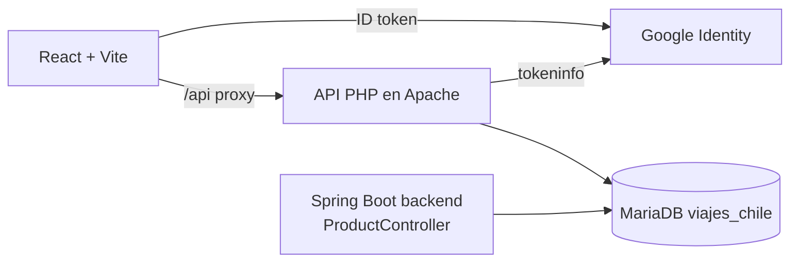

# Diagrama de APIs y lógica de negocio

## Arquitectura



## Endpoints y lógica de negocio

| Endpoint | Método | Acceso | Lógica / detalle del viaje |
|---|---|---|---|
| `auth.php?action=register` | POST | Público | Valida nombre, correo y contraseña ≥ 8; guarda `password_hash`; registra actividad. |
| `auth.php?action=login` | POST | Público | Verifica hash, regenera sesión, devuelve usuario y rol. |
| `auth.php?action=google` | POST | Público | Valida `credential` contra Google (`aud` = `GOOGLE_CLIENT_ID`, correo verificado); crea el usuario `customer` si no existe; abre sesión. |
| `auth.php?action=me` / `logout` | GET / POST | Sesión | Usuario actual / cierre de sesión. |
| `products.php` | GET | Público | Lista rutas: título, destino, precio, descuento, salidas (fecha, hora, andén, cupos). |
| `products.php` | POST/PUT/DELETE | Admin | Valida precio > 0, descuento 0–90 %, estado Activo/Agotado; administra salidas. |
| `purchase.php` | POST | Público | Transacción: bloquea la ruta (`FOR UPDATE`), valida salida y cupos, asigna asientos, aplica descuento, crea `sales` + `tickets`. Devuelve `sale_code`. |
| `purchase.php?code=` | GET | Código de compra | **Detalle del viaje**: por boleto ruta, destino, fecha, hora, andén, asiento, pasajero, RUT, precio original, % descuento, precio pagado, estado. |
| `sales.php` | PUT | Admin | Cancela boleto o venta completa con motivo; recalcula estado de la venta. |
| `reports.php` | GET | Admin | KPIs: ventas, boletos, viajes realizados, cancelaciones, reclamos, mensajes, usuarios nuevos. |
| `users.php` | GET | Admin | Lista clientes. |
| `contact.php` | POST/GET/PUT | Público/Admin | Mensajes y reclamos con estado leído/no leído/eliminado. |
| `fleet.php` | GET/POST | Admin | Eventos operativos de flota. |

## Flujo de compra

```mermaid
sequenceDiagram
  participant C as Cliente
  participant UI as React
  participant API as purchase.php
  participant DB as MariaDB
  C->>UI: Elige ruta, salida y pasajeros
  UI->>API: POST items[]
  API->>DB: BEGIN; SELECT product FOR UPDATE
  API->>DB: Asientos vendidos de la salida
  API->>API: Valida cupos, calcula descuento
  API->>DB: INSERT sales, tickets; COMMIT
  API-->>UI: sale_code
  UI->>API: GET ?code=sale_code
  API-->>UI: Detalle del viaje por boleto
```

## Login con Google

1. Crea un *OAuth Client ID* (Web) en Google Cloud con origen `http://localhost:5173`.
2. Frontend: variable `VITE_GOOGLE_CLIENT_ID` en `.env`.
3. Apache/PHP: variable de entorno `GOOGLE_CLIENT_ID` con el mismo valor.
