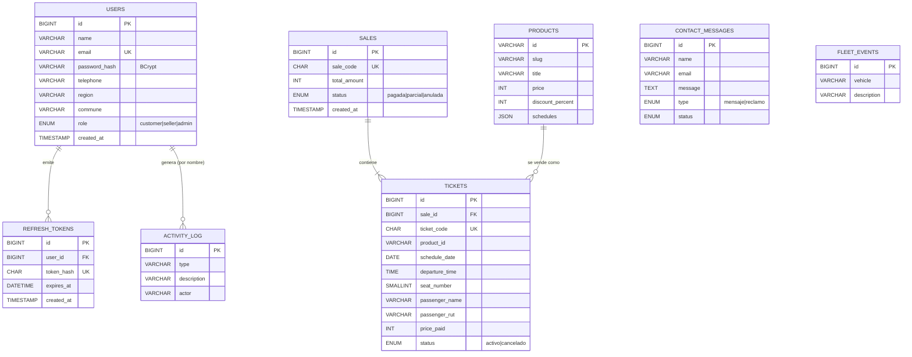
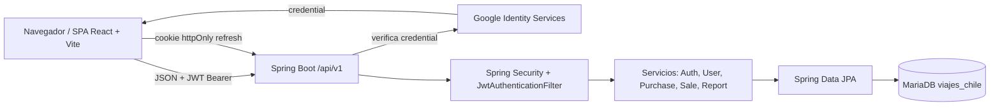

# Diagrama Entidad-Relación (MER) y arquitectura

## Modelo Entidad-Relación

## Arquitectura

Endpoints de cuenta: `POST /auth/login`, `/auth/register`, `/auth/google`, `/auth/refresh`, `/auth/forgot-password`, `/auth/reset-password`, `/auth/change-password` (autenticado), `GET|PUT /auth/me`, `POST /auth/logout`. Tabla asociada: `password_reset_tokens` (user_id, token_hash, expires_at).
